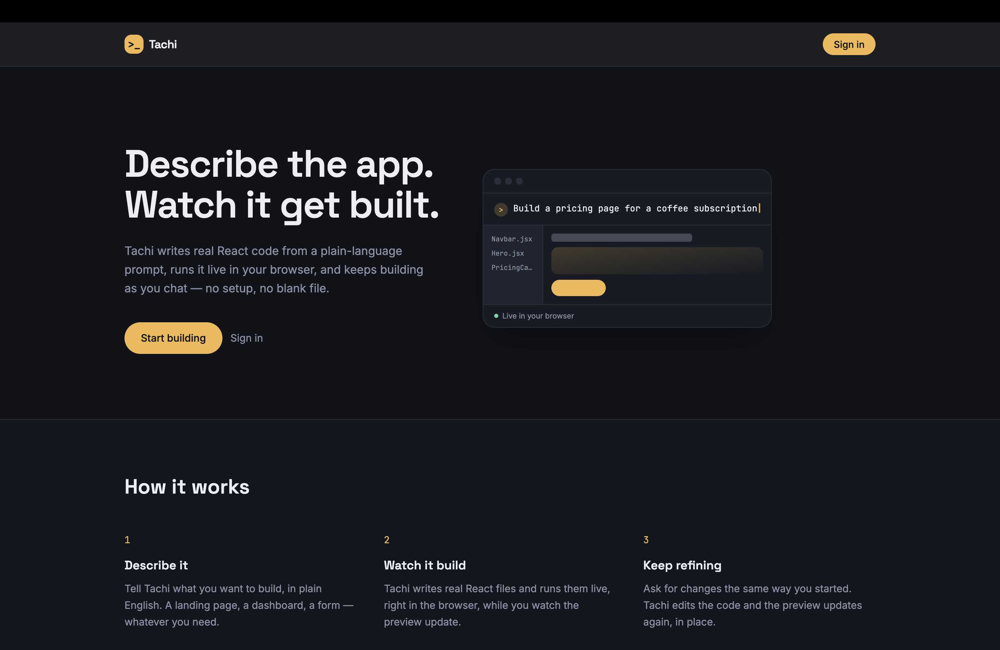
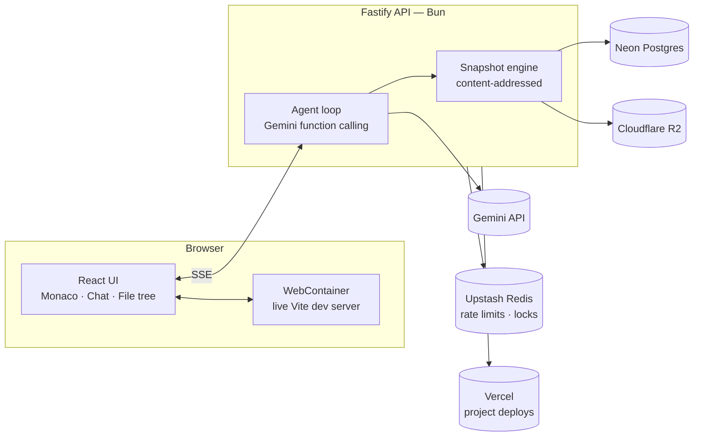

<div align="center">

# Tachi: Vibe Code IDE

**Describe the app. Watch it get built.**

An AI-first web app builder — chat with an agent that writes real React code, runs it live in your browser, and keeps iterating as you talk to it.

[](./LICENSE)


[Live demo](https://tachi-ide.vercel.app/) · [Report a bug](../../issues) · [Request a feature](../../issues)

</div>

<br />



## What is this?

Tachi is a from-scratch clone of the "AI app builder" category popularized by tools like Lovable, Bolt, and v0 — built to understand how that category of product actually works under the hood, end to end: an agentic tool-calling loop, a real in-browser dev runtime, content-addressed version history, and all the unglamorous plumbing (auth, rate limiting, billing, deploys) a real product needs around that core idea.

You type what you want. An AI agent writes actual files into a real project, which boots and runs **live in your browser** — no server-side build step, no waiting for a deploy. Ask for a change the same way, and it edits the running app in place. If something breaks, it can diagnose and fix its own mistake.

## Features

- 💬 **Chat-driven development** — describe a feature in plain English; the agent writes the code
- ⚡ **Live in-browser runtime** — powered by WebContainers, no server round-trip to see your app run
- 📝 **Real code editor** — Monaco-based editor with a live file tree, synced with the AI's changes in real time
- 🕘 **Full version history** — every change (yours or the AI's) is a snapshot; revert to any point, non-destructively
- 🩹 **Self-healing** — runtime and build errors are caught automatically, with one click to send them back to the AI for a fix
- 📦 **Export or deploy** — download your project as a zip, or ship it straight to Vercel
- 🔐 **Real auth, real limits** — Clerk-backed accounts, per-user rate limiting, and a usage ledger so one runaway session can't starve everyone else

## How it works



A chat message kicks off an agentic loop: the model is given a small set of tools (`read_file`, `edit_file`, `write_file`, `delete_file`, `add_dependency`, `finish`) and reasons its way through the task, calling them as needed. Every file change streams to the browser over SSE and is applied live to the running WebContainer — the preview updates without a page reload. Once the turn finishes, every touched file is hashed and stored (deduplicated across the whole project's history), and a new snapshot records the complete state at that point. Reverting just creates a new snapshot pointing at an old one's content — history is linear and nothing is ever destroyed.

## Tech stack

| Layer                 | Choice                                                   |
| --------------------- | -------------------------------------------------------- |
| Frontend              | React, Vite, TypeScript, Tailwind CSS, shadcn/ui         |
| In-browser runtime    | [WebContainers](https://webcontainers.io)                |
| Code editor           | Monaco                                                   |
| Backend               | Fastify on [Bun](https://bun.sh)                         |
| Database              | PostgreSQL ([Neon](https://neon.tech)) via Drizzle ORM   |
| Auth                  | [Clerk](https://clerk.com)                               |
| Object storage        | Cloudflare R2                                            |
| Cache / rate limiting | [Upstash](https://upstash.com) Redis                     |
| AI                    | Google Gemini (function calling)                         |
| Deploy targets        | Vercel (frontend + generated projects), Render (backend) |
| Observability         | Sentry                                                   |

## Getting started

### Prerequisites

Accounts for: [Neon](https://neon.tech), [Clerk](https://clerk.com), [Cloudflare R2](https://developers.cloudflare.com/r2/), [Upstash](https://upstash.com), [Google AI Studio](https://aistudio.google.com) (for a Gemini API key), and [Bun](https://bun.sh) installed locally.

### Setup

```bash
git clone https://github.com/akhtersoyeb/vibe-code-ide.git
cd vibe-code-ide

# Backend
cd apps/api
bun install
cp .env.example .env   # fill in your credentials
bun run db:generate && bun run db:migrate
bun run dev

# Frontend (in a second terminal)
cd apps/web
bun install
cp .env.example .env   # fill in your credentials
bun run dev

# Run Frontend + Backend (in one terminal)
bun run dev
```

The app runs at `http://localhost:5173`, the API at `http://localhost:8080`.

See [`DEPLOYMENT.md`](./DEPLOYMENT.md) for the full list of required environment variables and the production deployment setup (Vercel + Render).

### Tests

```bash
cd apps/api && bun run test
cd apps/web && bun run test && bun run test:e2e
```

## Project structure

```
vibe-code-ide/
├─ apps/
│  ├─ web/                  # React + Vite frontend
│  │  └─ src/
│  │     ├─ components/     # Workspace UI: editor, preview, chat, file tree
│  │     ├─ lib/            # Hooks: WebContainer runtime, API client, SSE
│  │     └─ pages/          # Route-level pages
│  └─ api/                  # Fastify backend
│     └─ src/
│        ├─ agent/          # Tool definitions, context building, the agent loop
│        ├─ routes/         # HTTP routes (projects, chat, webhooks)
│        ├─ storage/        # Content-addressed blob store, snapshot engine
│        ├─ billing/        # Usage ledger
│        ├─ deploy/         # Vercel deploy integration
│        └─ db/             # Drizzle schema and client
├─ DEPLOYMENT.md
└─ README.md
```

## Roadmap

- [x] Project CRUD, auth, and persistence
- [x] Live in-browser runtime with a real code editor
- [x] Agentic chat with streaming file edits
- [x] Snapshot history and non-destructive revert
- [x] Automatic error detection and self-fix loop
- [x] Rate limiting, usage ledger, and a concurrency lock per project
- [x] Export to zip, one-click deploy to Vercel
- [ ] Hardening: error tracking, tracing, and automated tests (in progress)
- [ ] Next.js project support via remote sandboxes
- [ ] Multi-file, multi-turn context retrieval for larger projects

## Contributing

Issues and PRs are welcome — this started as a learning project, so if you spot something that could be done better, I'd genuinely like to hear it.

## License

[MIT](./LICENSE)

## Author

Built by **Sk Soyeb Akhter** — [GitHub](https://github.com/akhtersoyeb/) · [Portfolio](https://soyeb.vercel.app/)
